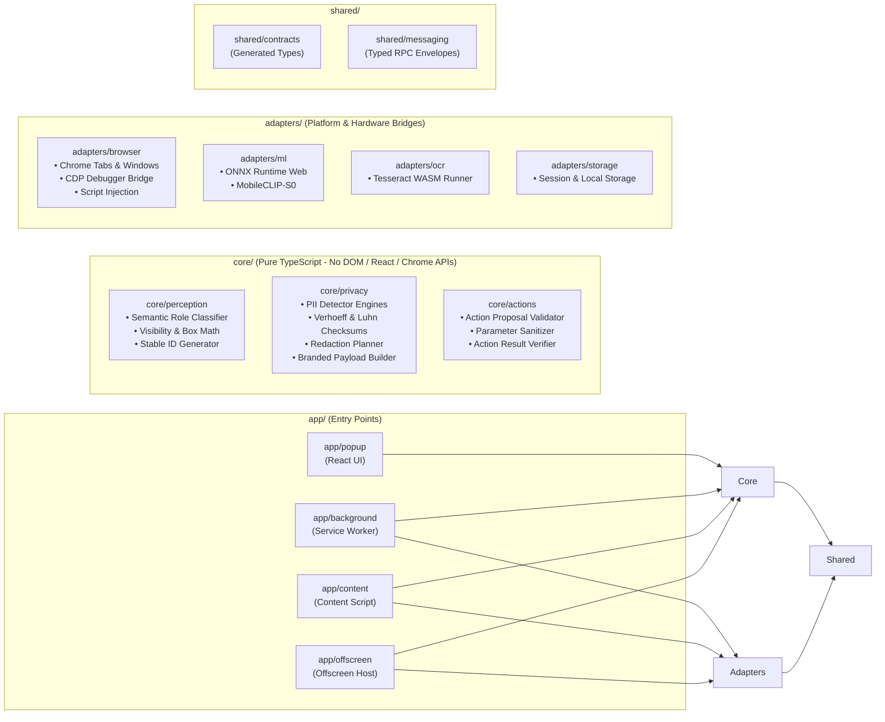

# NetraShield Target Architecture

**Status**: PROPOSED (Awaiting User Approval for Phase 3 Execution)  
**Author**: Principal Software Engineer & Security Architect  
**Date**: October 29, 2026  

---

## 1. Overview & Architectural Principles

NetraShield is an on-device, privacy-preserving visual perception browser agent designed to assist operators in executing multi-step web workflows while enforcing a mathematically verifiable, fail-closed privacy boundary.

### Core Architectural Invariant
> **Raw PII, credentials, passwords, raw page text, and unsanitized screenshots must never leave the client device.** All external reasoning requests receive strictly sanitized semantic payloads or fail-closed masked bitmaps.

### Architectural Principles
1. **Dependency Inversion (`app -> core <- adapters`)**:
   - The business core (`core/perception`, `core/privacy`, `core/actions`) is purely algorithmic and independent of UI frameworks (React) and runtime APIs (`chrome.*`, DOM, Node.js).
   - All I/O, browser manipulation, and ML inference are accessed via explicit adapter interfaces.
2. **Single Source of Truth (`contracts/`)**:
   - `contracts/netrashield.sanitized.v1.schema.json` is the definitive JSON Schema contract. TypeScript types and Python Pydantic models are code-generated from this schema in CI.
3. **Type-Safe Branded Privacy**:
   - Sanitized payloads use TypeScript branded types (`SanitizedPayload`), constructible only through certified redaction and validation pipelines in `core/privacy`. The transport layer statically forbids sending unbranded objects.
4. **Zero-Remote Default (Offline by Default)**:
   - All OCR (Tesseract.js WASM), visual grounding (MobileCLIP-S0 ONNX), and QR decoding (jsQR) run entirely offline in local workers with pinned assets.

---

## 2. C4 Architecture Models

### 2.1 C4 Level 1: System Context Diagram

```mermaid
flowchart TD
    User["Human Operator<br/>[Person]"]
    WebPage["Target Web Page<br/>[External System]"]
    Extension["NetraShield Extension<br/>[Software System - MV3]"]
    Server["Local Reasoning Server<br/>[Software System - Python/FastAPI]"]
    CloudLLM["Cloud LLM Provider<br/>[External System - Gemini/Groq]"]

    User -->|Enters task, inspects privacy, approves actions| Extension
    Extension -->|Captures DOM & redacts PII on-device| WebPage
    Extension -->|Executes approved clicks, typing, navigation| WebPage
    Extension <==|Sends Sanitized Payload over WebSocket (127.0.0.1)| Server
    Server -->|Sends sanitized prompts only (Zero PII)| CloudLLM
    CloudLLM -->|Proposes Next Action| Server
    Server -->|Requests Human Approval for High-Risk Action| Extension
```

---

### 2.2 C4 Level 2: Container Diagram

```mermaid
flowchart TD
    subgraph Browser Context ["Client Browser (Google Chrome / Chromium MV3)"]
        Popup["Popup / Detached Window<br/>[Container: React 19 / TypeScript]<br/>Operator chat, visual proofs, approval cockpit"]
        SW["Service Worker<br/>[Container: TypeScript / Vite]<br/>Session routing, transport, tab lifecycle"]
        CS["Content Script<br/>[Container: TypeScript / Vite]<br/>Thin injector, DOM walking, action execution"]
        OFF["Offscreen Document<br/>[Container: HTML / TypeScript / WASM]<br/>Tesseract OCR, MobileCLIP-S0, QR detection"]
    end

    subgraph Host Machine ["Local Workstation"]
        PyServer["Reasoning Server<br/>[Container: Python 3.13 / FastAPI]<br/>127.0.0.1:8787 - State loop, policy, planner"]
        AuditLog["Audit Ledger<br/>[File: Hash-Chained JSONL]<br/>Cryptographic proof of redaction"]
    end

    CS -->|DOM Tree & Geometry| SW
    SW -->|Capture & Redact Pixels| OFF
    OFF -->|OCR Regions & Visual Similarity| SW
    SW <==|Encrypted WebSocket /ws/agent| PyServer
    Popup <==|Encrypted WebSocket /ws/cockpit| PyServer
    PyServer -->|Writes Step Proofs| AuditLog
```

---

### 2.3 C4 Level 3: Extension Component Diagram



---

## 3. Explicit Layer Rules & Tooling Enforcement

### 3.1 Layer Dependency Constraints

```
┌────────────────────────────────────────────────────────┐
│                        app/                            │
│    (UI, Service Worker, Content Ingestion, Offscreen)  │
└───────────────────────────┬────────────────────────────┘
                            │ imports
                            ▼
┌────────────────────────────────────────────────────────┐
│                        core/                           │
│       (Pure Business Logic, Zero External I/O)         │
│   • core/perception    • core/privacy   • core/actions │
└───────────────────────────▲────────────────────────────┘
                            │ implemented by
┌───────────────────────────┴────────────────────────────┐
│                      adapters/                         │
│     (Browser APIs, Tesseract WASM, ONNX, Storage)      │
└───────────────────────────┬────────────────────────────┘
                            │ imports
                            ▼
┌────────────────────────────────────────────────────────┐
│                       shared/                          │
│     (Generated Contract Types, Branded Types, RPC)     │
└────────────────────────────────────────────────────────┘
```

### 3.2 Enforcement Rules
1. **Rule 1 (Pure Core)**:
   - Any file in `src/core/**` MUST NOT import from `react`, `react-dom`, `antd`, `@ant-design/*`, or reference global browser objects (`window`, `document`, `chrome`, `localStorage`).
   - All DOM operations and coordinates are represented as pure data structures (`ElementGeometry`, `BoundingBox`).
2. **Rule 2 (No Inward Leaks)**:
   - `core/` cannot import from `app/` or `adapters/`.
   - `adapters/` can import from `shared/` and `core/` types, but never from `app/`.
3. **Rule 3 (Branded Privacy Boundary)**:
   - Outbound WebSocket and HTTP transports accept ONLY the branded type `SanitizedPayload`.
   - The type constructor for `SanitizedPayload` is private to `core/privacy/payloadBuilder.ts`.
4. **Tooling Enforcement**:
   - Enforced in Phase 5 via `eslint-plugin-boundaries` and `dependency-cruiser` with zero allowed exceptions.

---

## 4. Target Directory Structure

```
Browser-s-Agent/
├── .github/
│   ├── workflows/
│   │   ├── ci.yml                 # Matrix test, lint, typecheck, eval gates
│   │   ├── codeql.yml             # Static security analysis
│   │   └── release.yml            # Automated signed zip packaging
│   └── dependabot.yml
├── contracts/
│   ├── netrashield.sanitized.v1.schema.json  # Single source of truth
│   └── envelope.v1.schema.json
├── docs/
│   ├── adr/                       # Architectural Decision Records
│   │   ├── 0001-vite-multi-entry-ts.md
│   │   ├── 0002-json-schema-contract-generation.md
│   │   ├── 0003-pure-core-architecture.md
│   │   ├── 0004-offline-fail-closed-verification.md
│   │   └── 0005-air-gapped-model-packaging.md
│   ├── architecture/
│   │   └── ARCHITECTURE.md        # This specification
│   ├── audit/
│   │   ├── AUDIT.md               # Phase 0 baseline audit
│   │   └── FINAL_REPORT.md        # Phase 9 closing scorecard
│   ├── metrics/
│   │   └── baseline.json          # Metric thresholds & ratchets
│   └── THREAT_MODEL.md            # STRIDE security analysis
├── scripts/
│   ├── check_gates.py             # Zero-pretence gate enforcement
│   ├── generate_contracts.py      # Schema -> TS & Pydantic codegen
│   └── fetch_offline_assets.mjs   # Pin and verify ONNX/WASM checksums
├── server/
│   ├── app/
│   │   ├── api/                   # FastAPI route controllers
│   │   ├── domain/                # State machine, policy, recovery logic
│   │   ├── services/              # Orchestration loop, sanitization pipeline
│   │   ├── adapters/llm/          # Gemini, Groq, OpenRouter clients
│   │   └── schemas/               # Generated Pydantic wire models
│   ├── eval/                      # Smoke runner & reproducible tasks
│   ├── fixtures/                  # Benchmark demo fixtures
│   └── tests/                     # Pytest suite
└── src/
    ├── app/
    │   ├── background/            # MV3 service worker entry point
    │   ├── content/               # MV3 content script entry point
    │   ├── offscreen/             # Offscreen WASM host entry point
    │   └── popup/                 # React UI entry point & cockpit
    ├── core/
    │   ├── perception/            # DOM walking, geometry math, stable IDs
    │   ├── privacy/               # PII regexes, checksums, redaction planner
    │   └── actions/               # Command parsing, validation & execution
    ├── adapters/
    │   ├── browser/               # Chrome tabs, CDP debugger, scripting
    │   ├── ml/                    # MobileCLIP-S0 ONNX Runtime wrapper
    │   ├── ocr/                   # Tesseract WASM runner
    │   └── storage/               # Chrome local/session storage wrappers
    └── shared/
        ├── contracts/             # Generated TypeScript wire contracts
        ├── messaging/             # Typed runtime RPC envelopes & guards
        └── lib/                   # Id generator, logger, config constants
```

---

## 5. Architectural Decision Summary (ADRs)

| ADR | Title | Decision | Impact |
| :--- | :--- | :--- | :--- |
| **ADR-001** | Multi-Entry TypeScript Bundling via Vite | Compile `background`, `content`, and `offscreen` as first-class TypeScript modules through Vite Rollup configs instead of leaving uncompiled JS in `public/`. | Enables compile-time type safety, dead-code elimination, and linting across the entire extension lifecycle. |
| **ADR-002** | Single Source of Truth via JSON Schema | Author `contracts/netrashield.sanitized.v1.schema.json` and generate both TS interfaces and Pydantic models with `extra="forbid"`. | Eliminates contract drift between TypeScript extension and Python reasoning server. |
| **ADR-003** | Pure Core Architecture | Split god files into pure mathematical/algorithmic core modules with zero DOM or browser API imports. | Allows 100% unit test coverage for detectors, box math, and redaction in pure Node/Vitest. |
| **ADR-004** | Fail-Closed Verification & Offline AI | Blackout raw canvas captures before any transmission; re-OCR redacted screenshot with offline Tesseract; withhold capture if leak detected. | Prevents silent data leakage due to DOM-to-canvas coordinate scaling errors. |
| **ADR-005** | Air-Gapped Asset Management & Git Hygiene | Remove committed 45.9 MB zip archive and 76.5 MB model weights from Git tracking; provide automated build-time checksum-pinned verification. | Adheres to repository hygiene standards, minimizes git clone bloat, and guarantees supply chain integrity. |

---

## 6. Migration Protocol for Phase 3

Upon user approval:
1. **Step 3.1**: Create `contracts/` and generate typed contracts.
2. **Step 3.2**: Extract `core/privacy` and `core/perception` into pure TypeScript modules with unit tests.
3. **Step 3.3**: Configure Vite multi-entry build (`popup`, `background`, `content`, `offscreen`).
4. **Step 3.4**: Clean up legacy dead files (`public/content-script.js`, `public/content.js`).
5. **Step 3.5**: Verify that all baseline commands pass:
   `npm run lint && npm run build && npm test && npm run test:py && npm run smoke && npm run gates`.
